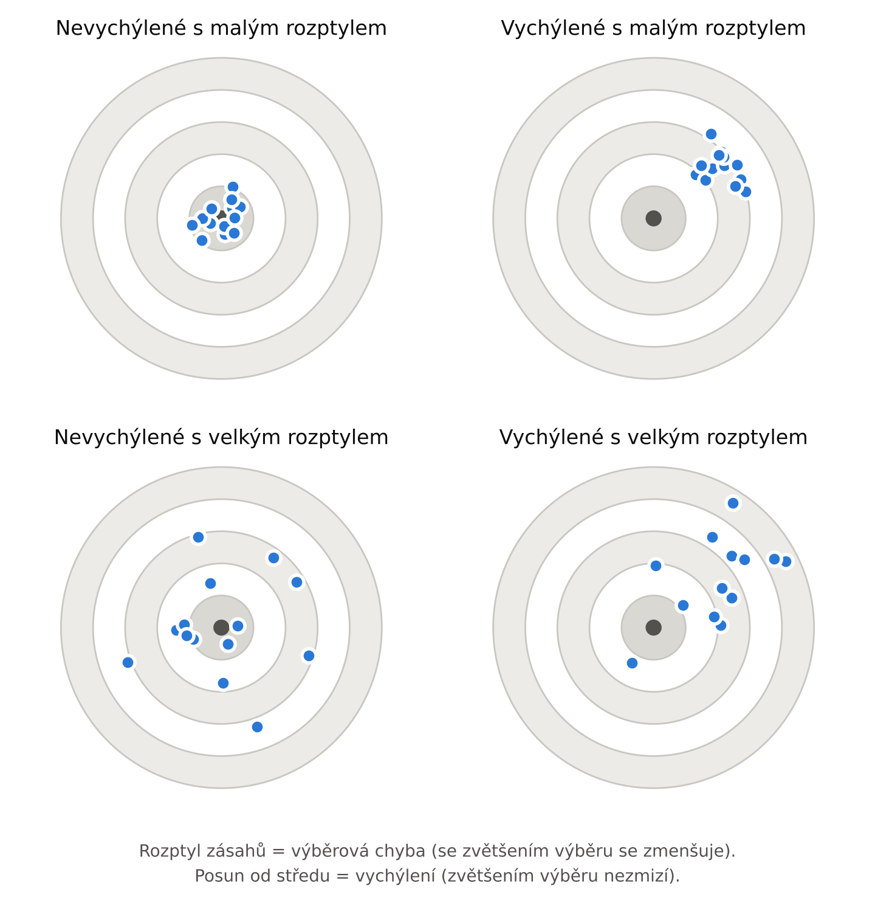
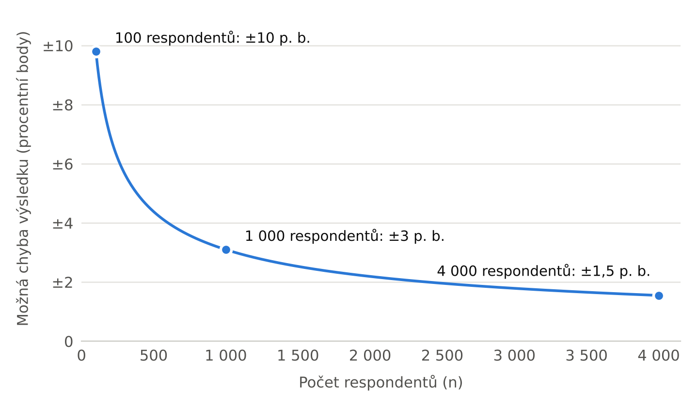

# 2. Zdroje dat

## 2.1 Proces analýzy dat a zdroje dat

Pokud chceme provést kvalitní datovou analýzu zvoleného problému, nejde jen o volbu vhodné statistické metody, ale o celý proces, který se skládá z několika kroků:

1. **Získání kvalitního datového souboru** (velmi důležitá část analýzy; známé rčení „garbage in, garbage out“ vystihuje, že z nekvalitních dat nelze získat kvalitní výsledky)
2. **Předzpracování dat** (převod zdrojového datového souboru do formátu pro vybraný statistický nástroj, kontrola chyb, vyhodnocení chybějících hodnot apod.)
3. **Samotná analýza dat** (výběr a správné použití statistických metod)
4. **Interpretace výsledků** (tvorba prezentací, vizualizace, popis výsledků)

Všechny tyto kroky jsou pro statistika důležité a v průběhu kurzu celý tento proces obsáhneme.

V dnešní době počítačové techniky a internetu jsou vůbec nejobjemnější formou strukturovaných dat tzv. **administrativní data**, která se týkají činnosti firem nebo úřadů (daně, sociální a zdravotní pojištění, evidence pracovní neschopnosti apod.), a **transakční data** (nákupy v e-shopu, návštěvníci webové stránky apod.). Zde se tak jedná spíše o zachycení nějaké aktivity. Pro datovou analýzu jsou však velmi důležitá, protože nám pomáhají odhalit finanční podvody či hackerské útoky, přizpůsobit webové stránky uživatelům nebo optimalizovat chod firmy. Často ale neobsahují subjektivní názory lidí. K tomuto účelu proto obvykle používáme data pocházející z **výběrových šetření**.

Data, ať už z výběrových šetření, nebo z jiných zdrojů, můžeme rozdělit na **primární data** (sbíráme je sami) a **sekundární data** (nasbíral je někdo jiný). Primární data mají výhodu v tom, že slouží přesně k účelu, který odpovídá přání zadavatele. Nevýhodou je ale finanční náročnost, pomalost sběru i fakt, že lze snadno udělat chybu nebo něco nedomyslet a data tak znehodnotit nebo alespoň zkomplikovat jejich analýzu. I to je jeden z důvodů, proč je dobré ovládat techniky výběrových šetření.

Naproti tomu sekundární data již někdo nasbíral (byť třeba i pro trochu jiný účel), ale pro naši analýzu jsou vhodná. Taková data jsou levná (mnohdy zcela zdarma) a obvykle rychle k dispozici. Jejich sběr ale nemůžeme ovlivnit a cizí chyby často jen těžko odhalíme. Pokud se pro analýzu sekundárních dat rozhodneme, potom je můžeme získat buď z veřejných, nebo z privátních zdrojů.

**Veřejné zdroje:**

- [Český statistický úřad (ČSÚ)](https://csu.gov.cz): [Veřejná databáze](https://vdb.czso.cz), sčítání lidu, Výběrové šetření pracovních sil (VŠPS), šetření Životní podmínky (EU-SILC), národní účty, index spotřebitelských cen (CPI)
- [Česká národní banka (ČNB)](https://www.cnb.cz): databáze [ARAD](https://www.cnb.cz/arad/#/cs/home)
- ministerstva, např. [Ministerstvo práce a sociálních věcí (MPSV)](https://mpsv.gov.cz), [Ministerstvo financí (MF)](https://mf.gov.cz), [Ministerstvo školství, mládeže a tělovýchovy (MŠMT)](https://msmt.gov.cz)
- [Ústav zdravotnických informací a statistiky (ÚZIS)](https://www.uzis.cz)
- [Národní katalog otevřených dat](https://data.gov.cz) (data.gov.cz)
- mezinárodní instituce: [Eurostat](https://ec.europa.eu/eurostat) (harmonizovaná data za státy EU, dodává je i ČSÚ), [OECD](https://www.oecd.org), [Světová banka](https://data.worldbank.org), [Mezinárodní měnový fond (MMF)](https://www.imf.org), [OSN](https://data.un.org)

**Privátní zdroje:**

- výzkumné agentury, např. [STEM](https://www.stem.cz), [Median](https://www.median.eu), [Kantar](https://www.kantar.com), [Ipsos](https://www.ipsos.com/cs-cz) nebo [NMS](https://nms.global/cz/); standardy kvality pro ně stanovuje sdružení [SIMAR](https://www.simar.cz)
- akademická pracoviště, např. [Centrum pro výzkum veřejného mínění (CVVM)](https://cvvm.soc.cas.cz) při [Sociologickém ústavu AV ČR](https://www.soc.cas.cz)
- komerční databáze
- interní data firem

Tato data bývají aktuálnější, podrobnější a připravená na míru. Jsou ale placená, metodika často není veřejná a hrozí střet zájmů zadavatele, který volí otázky i to, co se zveřejní. Je také třeba řešit ochranu osobních údajů (GDPR).

## 2.2 Výběrová šetření a metody výběru

S výběrovým šetřením se lze snadno setkat i v médiích. Typickým příkladem, který viděl téměř každý, je odhad volebních preferencí, tzv. **volební model**. Kritikou ze strany veřejnosti a politiků se nešetří. Bohužel se síla této kritiky velmi často odvíjí od samotných výsledků průzkumu a od toho, kterému politickému táboru daný člověk zrovna fandí. Lze ale takový průzkum kritizovat i z čistě odborného hlediska? Ano, nejprve si ale rozeberme základní pojmy.

Cílem výběrového šetření je dozvědět se něco o celé populaci (tzv. **základním souboru**), aniž bychom se museli ptát všech. Respondenty proto vybíráme ze seznamu jednotek populace, kterému říkáme **opora výběru**. Ideální oporou by byl registr obyvatel, ten ale není komerčním agenturám dostupný. V praxi se tedy užívají adresy z veřejného Registru územní identifikace, adres a nemovitostí (RÚIAN), online panely respondentů nebo generovaná telefonní čísla. Už samotná volba opory může zásadně zkreslit výsledek, protože opora často nezahrnuje celou populaci, ale jen její specifickou (mnohdy nenáhodnou) část. Tomuto zkreslení říkáme **chyba pokrytí**.

Pokud již máme k dispozici oporu výběru, lze z ní vybrat **výběrový soubor**, tedy tu část populace, které se skutečně zeptáme. První způsob výběru se nazývá **pravděpodobnostní (náhodný) výběr**: o zařazení rozhoduje náhoda, nikoli člověk, a každá jednotka má známou nenulovou pravděpodobnost, že bude vybrána. Ze statistického hlediska je lepší v tom smyslu, že lze spočítat velikost tzv. **výběrové chyby**, tedy nakolik se výsledek může lišit od skutečnosti jen proto, že jsme se neptali všech. Má čtyři základní podoby:

- **Prostý náhodný výběr**: jednotky losujeme z úplného seznamu populace. Je to teoretický ideál, v praxi se ale používá zřídka, protože úplný seznam obvykle chybí.
- **Systematický výběr**: náhodně zvolíme první jednotku a potom bereme každou $k$-tou v seznamu. Je-li seznam pravidelně uspořádán (např. každý desátý byt je rohový), může výběr dopadnout jednostranně.
- **Stratifikovaný výběr**: populaci rozdělíme do vrstev (např. podle kraje, věku nebo velikosti firmy) a losujeme v každé zvlášť. Každá vrstva je tak ve výběru zastoupena a výsledek je přesnější. Na tomto principu stojí např. řada šetření ČSÚ.
- **Skupinový a vícestupňový výběr**: losujeme celé skupiny jednotek, např. obce. Pokud v nich losujeme dál, např. adresy a v domácnosti jednu osobu (třeba tu, která měla naposledy narozeniny), jde o výběr vícestupňový. Tazatelé nemusejí tolik cestovat, takže je sběr levnější, přesnost je ale o něco nižší.

Pravděpodobnostní výběr je ale drahý a pomalý a potřebuje kvalitní oporu. Druhým způsobem je proto **nepravděpodobnostní výběr**. Sem řadíme především **kvótní výběr**, který stojí na znalosti struktury populace podle tzv. kvótních znaků (pohlaví, věk, vzdělání, kraj). Tato struktura se nejčastěji přebírá z veřejných statistik (sčítání lidu, VŠPS apod.). Tazatel potom dostane předpis, kolik lidí s jakými znaky má dotázat (např. 5 žen ve věku 30–44 let se středoškolským vzděláním ze Středočeského kraje), a koho konkrétně osloví, je už na něm. Jedná se o dominantní typ výběru v komerční sféře a u většiny volebních průzkumů, protože je rychlý, levný a nepotřebuje oporu výběru. Pojí se s ním ale zásadní problém: soubor se populaci podobá jen v kvótních znacích. Ve všem ostatním rozhoduje tazatel a jeho pohodlí (kdo je doma, otevře, má čas, rád mluví). Souvisí-li ochota odpovídat se zkoumaným jevem, vzniká zkreslení, které kvóty neodstraní.

Mezi další nepravděpodobnostní výběry patří např.:

- **Příležitostný výběr**: ptáme se toho, kdo je zrovna po ruce.
- **Samovýběr**: respondenti se do šetření zapojí sami (anketa na webu, sdílený dotazník, hlasování diváků).
- **Metoda sněhové koule**: respondenti doporučují další respondenty ze svého okolí. Hodí se pro skryté populace, které nelze oslovit jinak.

U těchto výběrů ale reprezentativitu z podstaty zajistit nelze.

## 2.3 Metody sběru dat

Zatímco se metody výběru týkaly toho, jakým způsobem respondenty vybíráme, metody sběru se týkají toho, jakým způsobem od respondentů data získáváme. V praxi se setkáme se čtyřmi základními typy:

- **CAWI** (Computer Assisted Web Interviewing, online dotazování) je dnes vůbec nejběžnější způsob dotazování, protože je velmi levný, rychlý a data lze snadno zpracovat. Ukazuje se také, že respondenti bývají upřímnější, protože před sebou nemají tazatele. Nevýhodou ovšem je, že obsáhne pouze tu část populace, která je k dispozici online. Výsledky jsou tak už z podstaty zatíženy chybou pokrytí. Zaslání dotazníku navíc občas komplikují různé spamové filtry.
- **CATI** (Computer Assisted Telephone Interviewing, telefonické dotazování) je typ sběru, pomocí kterého jsme čistě teoreticky schopni zasáhnout téměř celou populaci. Negativní roli ale hraje nízká ochota odpovídat po telefonu.
- **CAPI** (Computer Assisted Personal Interviewing, osobní dotazování s tabletem či notebookem) je oblíbené, protože můžeme oslovit i obyvatele bez telefonu nebo internetu. Rozhovor navíc provádí školený tazatel, který může vysvětlit případné nejasnosti v otázkách. Tento typ sběru je ale drahý a vstupuje do něj tzv. **efekt tazatele**. Lidé se před cizím člověkem snaží jevit lepšími, než ve skutečnosti jsou, a ne vždy odpovídají dle pravdy. Tazatel si navíc v případě kvótního výběru může vybírat jen lidi, kteří jsou mu sympatičtí, a tak dochází k dalšímu zkreslení. Dalším problémem je časová náročnost a horší dostupnost některých lokalit.
- **PAPI** (Paper and Pencil Interviewing, osobní dotazování s papírovým dotazníkem) má podobné výhody jako CAPI, ale zpracování dat je mnohem obtížnější, protože odpovědi je třeba ručně přepsat. Proto se dnes příliš nevyužívá. Vyplňuje-li respondent papírový dotazník sám bez tazatele (např. při zaslání poštou), je situace ještě komplikovanější: nejasnosti mu nemá kdo vysvětlit a návratnost bývá nízká.

## 2.4 Chyby výběrových šetření a velikost výběru

Vraťme se nyní k volebnímu modelu, který jsme brali jako mediálně známý příklad výběrového šetření. Hlavní věc, kterou bychom právem očekávali, je přesnost, nebo alespoň tzv. **nevychýlené výsledky** se známou chybou. Takové výsledky se v průměru trefují do středu terče, zatímco **vychýlené výsledky** jsou soustavně posunuté jedním směrem, viz [Obr. 2.1](#obr-2-1).

**Obrázek 2.1** Výběrová chyba a vychýlení na příkladu střelby do terče. Střed terče odpovídá skutečné hodnotě v populaci. {#obr-2-1}

V průzkumech se často uvádí statistická (výběrová) chyba. Tu lze ale korektně spočítat jen u pravděpodobnostního výběru. U kvótního výběru je uváděná hodnota jen orientační, protože je vypůjčená z teorie náhodného výběru. Důležitější bývají **nevýběrové chyby**. Postihují každé šetření bez ohledu na způsob výběru, s rostoucím počtem respondentů se nezmenšují a dají se jen těžko změřit:

- **Chyba pokrytí**: opora výběru nezahrnuje část populace (lidi bez telefonu, bez internetu, bez adresy).
- **Chyba z neodpovědí** (nonresponse): část oslovených neodpoví a liší se od těch, kteří odpoví.
- **Chyba měření**: respondent otázce nerozumí, nepamatuje si, nebo odpovídá tak, jak se podle něj očekává (tzv. sociální žádoucnost).
- **Chyba zpracování**: překlepy a chyby při kódování a přenosu dat.

Vlivem nevýběrových chyb a faktu, že se u volebního modelu s největší pravděpodobností jedná o kvótní výběr, nemůžeme míru vychýlení ani možnou chybu dost dobře kvantifikovat.

Kvótní výběr (a s ním volební model či jiný podobný průzkum) přitom není z principu špatný. Základní odhady potřebné pro byznys nám dává. Statistikům to ovšem často nestačí. Proto mnohem raději vidíme výběr pravděpodobnostní, u něhož jsme v ideálním případě, kdy všichni respondenti odpoví pravdivě, schopni výběrovou chybu odhadnout. Takové situaci se nejvíce blížíme, když náhodně vybíráme z transakčních nebo administrativních dat. Zde máme úplný seznam, nikdo neodmítne odpovědět a údaje nejsou zkreslené pamětí ani snahou vypadat lépe. To však platí jen tehdy, zajímají-li nás právě ti, kdo v datech jsou (např. zákazníci e-shopu).

Stojí za zmínku, že výběrová chyba prakticky nezávisí na velikosti cílové populace $N$ (pokud je výběr vůči populaci malý), což může být překvapivé. Pro náhodný výběr $n = 1\,000$ respondentů tedy bude v USA stejná jako v Česku. Chyba je navíc nepřímo úměrná odmocnině z $n$ (pro směrodatnou chybu platí $SE \propto 1/\sqrt{n}$). U malých výběrů je proto poměrně vysoká a se zvětšováním výběru zpočátku rychle klesá, u velkých výběrů už ale jen pomalu: pro poloviční chybu potřebujeme vždy čtyřnásobek respondentů. Pro představu (viz [Obr. 2.2](#obr-2-2)): u 100 respondentů se výsledek může od skutečnosti lišit zhruba až o ±10 procentních bodů (p. b.), u 1&nbsp;000 zhruba až o ±3 p. b. a u 4&nbsp;000 zhruba až o ±1,5 p. b. Proto se velikost výběru často pohybuje v řádu tisíců: další zvětšování by už chybu snížilo jen málo, a přitom by zvýšilo finanční náklady.

**Obrázek 2.2** Jak klesá možná chyba výsledku s počtem respondentů. {#obr-2-2}
