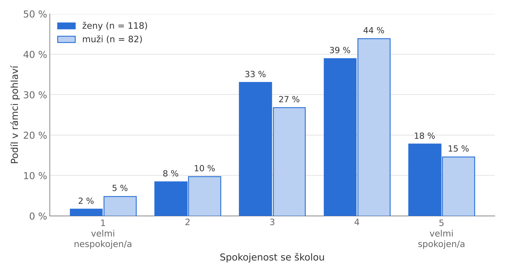
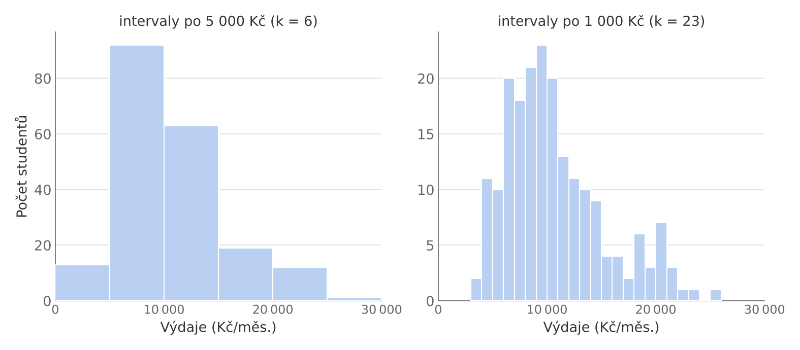

# 3.2 Grafické zobrazení četností

## Sloupcový graf

Tabulka četností nám dává **tvar rozdělení**, ze kterého lze přímo odvodit další charakteristiky, jako jsou minimum, maximum, nejčastější kategorie apod. K vizualizaci kategoriální proměnné se používá sloupcový nebo výsečový graf. Výsečový graf se ovšem nedoporučuje: lidské oko špatně porovnává úhly a plochy, při větším počtu kategorií je graf nečitelný a pro srovnání dvou skupin (např. žen a mužů) je nutné nakreslit dva samostatné grafy. Sloupcový graf všechny tyto nevýhody řeší, protože délky sloupců se porovnávají snadno a srovnání skupin se vejde do jednoho obrázku, viz [Obr. 3.1](#obr-3-1).

**Obrázek 3.1** Spokojenost se školou podle pohlaví ($n = 200$). Protože skupiny mají různou velikost (118 žen a 82 mužů), srovnáváme relativní četnosti spočítané zvlášť pro každou skupinu. {#obr-3-1}

## Histogram

Jedná-li se o kvantitativní proměnnou, využíváme k zobrazení tvaru rozdělení **histogram**. Důležitý je zde princip konstrukce: obor hodnot proměnné (od minima po maximum) se rozdělí na $k$ intervalů, obvykle stejné šířky, a v každém z intervalů se spočítá četnost. Histogram je tedy graficky zobrazená tabulka četností, jako je [Tab. 3.2](/4st102/03-1-tabulky-cetnosti#tab-3-2). Na rozdíl od sloupcového grafu se jeho sloupce navzájem dotýkají, protože intervaly na číselné ose plynule navazují.

Počet intervalů je volbou analytika a rozhoduje se o něm podle účelu vizualizace. Málo intervalů tvar rozdělení vyhladí, příliš mnoho z něj udělá hřeben náhodných výkyvů. Jako výchozí odhad lze použít Sturgesovo pravidlo

$$k \approx 1 + 3{,}3 \log_{10} n,$$

které pro $n = 200$ dává zhruba 9 intervalů. Jde však jen o orientační pravidlo (anglicky *rule of thumb*), nikoli o optimální volbu: vychází z předpokladu přibližně souměrného rozdělení, a u velkých souborů nebo silně zešikmených dat proto obvykle dává příliš málo intervalů. Výsledný histogram je tak vždy potřeba posoudit očima a počet intervalů případně upravit. Že volba není jen kosmetická, ukazuje [Obr. 3.2](#obr-3-2): v hrubším histogramu vypadají výdaje jako jednoduchý kopec, v jemnějším se objeví i malá skupina studentů s výdaji kolem 20&nbsp;000 Kč.

**Obrázek 3.2** Měsíční výdaje studentů ve dvou histogramech: intervaly po 5&nbsp;000 Kč (vlevo, odpovídá [Tab. 3.2](/4st102/03-1-tabulky-cetnosti#tab-3-2)) a po 1&nbsp;000 Kč (vpravo), $n = 200$. Stejná data, různá podrobnost. {#obr-3-2}

Histogram je v analýze dat stěžejní nástroj, který pomůže velmi rychle odhalit různé anomálie (chyby měření, extrémní hodnoty apod.).
