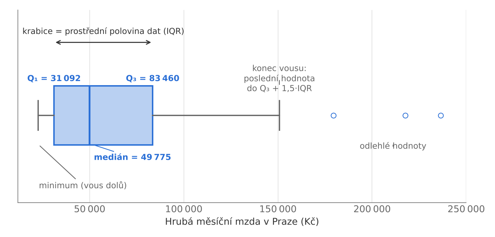

# 3.4 Míry variability

Míry variability popisují, jak jsou hodnoty proměnné rozptýleny kolem své polohy.

## Rozpětí a mezikvartilové rozpětí

$$R = x_{\max} - x_{\min}, \qquad IQR = Q_3 - Q_1$$

**Rozpětí** závisí jen na dvou krajních hodnotách, a je proto citlivé na extrémy. **Mezikvartilové rozpětí** je šířka intervalu, ve kterém leží prostřední polovina hodnot (kvartily $Q_1$ a $Q_3$ viz [kap. 3.3](/4st102/03-3-miry-polohy)); extrémní hodnoty je neovlivní.

## Rozptyl a směrodatná odchylka

$$s^2 = \frac{1}{n-1}\sum_{i=1}^{n}(x_i - \bar{x})^2, \qquad s = \sqrt{s^2}$$

**Rozptyl** měří velikost čtvercových odchylek hodnot od aritmetického průměru a vychází ve čtvercových jednotkách. **Směrodatná odchylka** je jeho odmocnina v původních jednotkách proměnné. Dělení $n - 1$ dává výběrový rozptyl, který se používá, chápeme-li data jako výběr z větší populace; dělení $n$ dává populační rozptyl $s_n^2 = \frac{1}{n}\sum (x_i - \bar{x})^2$.

Pro tříděná data se středy intervalů $x_i$ a četnostmi $n_i$ platí

$$s^2 = \frac{\sum_{i=1}^{k} n_i (x_i - \bar{x})^2}{n - 1},$$

kde $\bar{x}$ je vážený aritmetický průměr.

## Variační koeficient

$$V_x = \frac{s}{\bar{x}} \cdot 100\ \%$$

Směrodatná odchylka vyjádřená v procentech průměru. Umožňuje srovnat variabilitu proměnných s různými jednotkami nebo různou úrovní. Má smysl jen pro proměnné s přirozenou nulou a kladným průměrem, který není blízký nule.

## Krabičkový graf

**Pětičíselný souhrn** tvoří minimum, $Q_1$, medián, $Q_3$ a maximum. Zobrazuje jej **krabičkový graf** ([Obr. 3.3](#obr-3-3)): krabice sahá od $Q_1$ do $Q_3$, čára uvnitř krabice vyznačuje medián. Vousy vedou k nejvzdálenějším hodnotám, které leží v intervalu $\langle Q_1 - 1{,}5 \cdot IQR;\ Q_3 + 1{,}5 \cdot IQR \rangle$; hodnoty mimo tento interval se vykreslují samostatně jako odlehlé. Nejsou-li v souboru odlehlé hodnoty, sahají vousy k minimu a maximu.

**Obrázek 3.3** Části krabičkového grafu (hrubé měsíční mzdy v Praze, $n = 100$). {#obr-3-3}
